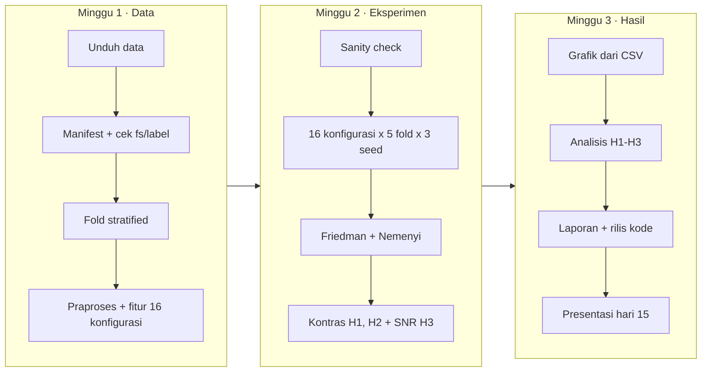
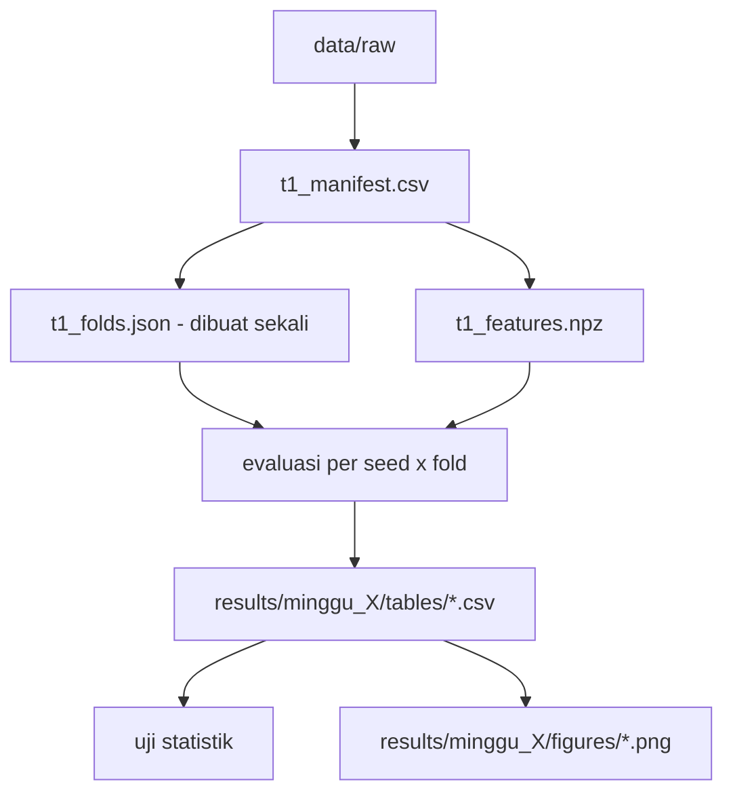

# Analisis Window STFT pada Suara Burung Hama Padi

Mata kuliah **Sinyal & Sistem** · Kelompok 1 · 3 minggu (15 hari kerja)

**Judul:** Analisis Pengaruh Ukuran dan Jenis Window STFT terhadap Representasi Spektral dan Klasifikasi Suara Burung Hama Padi

**Dataset:** [Multimodal Computer Vision and Acoustic Bird Detection Dataset for Smart Rice Farming Environments](https://data.mendeley.com/datasets/p6m5tmr477/1) (Mendeley Data `p6m5tmr477`, CC BY 4.0). Subset audio: >20.000 klip 2–3 detik, 6 kelas (common waxbill, red-billed quelea, village weaver, yellow-fronted canary, other birds, environmental noise).

| Hipotesis | Pernyataan | Diuji dengan |
| --- | --- | --- |
| H1 | Window 512–1024 sampel (≈ 23–46 ms pada 22,05 kHz) menghasilkan macro-F1 lebih tinggi daripada 256 dan 2048 | Friedman + Nemenyi, Wilcoxon kontras |
| H2 | Window sidelobe rendah (Hann, Blackman) mengungguli rectangular, terutama untuk memisahkan burung dari noise | Friedman + Nemenyi, Wilcoxon kontras pada F1 kelas noise |
| H3 | Bandpass 1–10 kHz menaikkan SNR kelas burung secara signifikan | Wilcoxon berpasangan |

---

## Daftar Isi

1. [Struktur repositori](#1-struktur-repositori)
2. [Setup lingkungan](#2-setup-lingkungan)
3. [Desain eksperimen](#3-desain-eksperimen)
4. [Aturan anti-error](#4-aturan-anti-error-wajib-dibaca)
5. [Alur keseluruhan](#5-alur-keseluruhan)
6. [Modul bersama](#6-modul-bersama-srccommonpy)
7. [Minggu 1 — Data](#7-minggu-1-hari-15--data)
8. [Minggu 2 — Eksperimen](#8-minggu-2-hari-610--eksperimen-inti)
9. [Minggu 3 — Hasil](#9-minggu-3-hari-1115--hasil)
10. [Grafik analisis](#10-grafik-analisis)
11. [Skema tabel hasil](#11-skema-tabel-hasil)
12. [CNN opsional](#12-cnn-opsional)
13. [Pemetaan ke matriks penilaian](#13-pemetaan-ke-matriks-penilaian)
14. [Troubleshooting](#14-troubleshooting)

---

## 1. Struktur repositori

```
bird-stft/
├── README.md
├── requirements.txt
├── run_pipeline.py            # Orkestrator eksekusi semua tahapan
├── data/
│   ├── raw/                   # Audio dataset Mendeley (bird_sounds)
│   └── interim/               # Manifest, fold JSON, dan cache fitur .npz
├── src/
│   ├── common.py              # Path terpusat, fold, utilitas statistik
│   ├── config.py              # Konfigurasi parameter audio & STFT
│   ├── features.py            # Praproses sinyal & ekstraksi MFCC 16 konfigurasi
│   ├── preprocess.py          # Desain filter IIR Butterworth vs FIR
│   ├── plots.py               # Seluruh fungsi visualisasi domain sinyal & sistem
│   ├── week1_prepare.py       # Minggu 1: Manifest, validasi data, split 5-fold
│   ├── week1_build_features.py# Minggu 1: Ekstraksi fitur STFT & tabel resolusi
│   ├── week2_experiment.py    # Minggu 2: Evaluasi 240 fold SVM, Friedman, Nemenyi
│   ├── week2_hypotheses.py    # Minggu 2: Pengujian hipotesis H1 & H2 (Wilcoxon)
│   ├── week2_snr.py           # Minggu 2: Pengujian hipotesis H3 (Gain SNR filter)
│   └── week3_report.py        # Minggu 3: Matriks konfusi, spektrogram & ringkasan akhir
└── results/
    ├── minggu_1/              # Luaran Minggu 1 (Data & Praproses)
    │   ├── figures/           # PNG: waveform sinyal, respons filter, PSD, resolusi STFT
    │   └── tables/            # CSV: manifest, distribusi dataset, waktu ekstraksi, resolusi
    ├── minggu_2/              # Luaran Minggu 2 (Eksperimen Inti 16 Konfigurasi)
    │   ├── figures/           # PNG: heatmap F1, boxplot, kurva F1 vs N, SNR paired, tradeoff
    │   └── tables/            # CSV: 240 fold scores, uji Friedman, Nemenyi, kontras H1-H2, SNR
    └── minggu_3/              # Luaran Minggu 3 (Laporan & Pembahasan Akhir)
        ├── figures/           # PNG: matriks konfusi normalisasi, spektrogram STFT, MFCC
        └── tables/            # CSV: metrik window, F1 per kelas, ringkasan akhir 16 config
```

Jalankan dari root repositori dengan `python -m src.week1_prepare` (bukan `python src/week1_prepare.py`) agar `import src.common` selalu benar.

## 2. Setup lingkungan

```bash
python -m venv .venv
.venv\Scripts\activate            # Windows;  Linux/macOS: source .venv/bin/activate
pip install -r requirements.txt
pip freeze > requirements.lock.txt   # simpan versi persis untuk reproduksibilitas
```

`requirements.txt`

```
numpy>=1.26
scipy>=1.11
pandas>=2.1
librosa>=0.10
soundfile>=0.12
scikit-learn>=1.3
scikit-posthocs>=0.9
matplotlib>=3.8
seaborn>=0.13
joblib>=1.3
tqdm>=4.66
torch            # hanya untuk CNN opsional
```

> **Windows:** skrip yang memakai `joblib` wajib memakai `if __name__ == "__main__":` (sudah ada di semua contoh). Tanpa blok ini, proses akan menjalankan ulang dirinya sendiri.

## 3. Desain eksperimen

| Komponen | Nilai |
| --- | --- |
| Sample rate kerja | 22.050 Hz (semua klip di-resample ke satu fs) |
| Pre-emphasis | `y[n] = x[n] − 0,97·x[n−1]` |
| Bandpass | Butterworth orde 4, 1–10 kHz (zero-phase `sosfiltfilt`) |
| Grid utama | 4 ukuran N (256, 512, 1024, 2048) × 4 window (rectangular, Hann, Hamming, Blackman), overlap 50% → **16 konfigurasi** |
| Fitur | MFCC 13 + Δ-MFCC, statistik (mean, std) per klip = **52 dimensi** |
| Model | StandardScaler + SVM RBF (`C=10`, `gamma="scale"`, `class_weight="balanced"`) |
| Validasi | 5-fold stratified × 3 seed (0, 1, 2) = **15 blok** per konfigurasi |
| Metrik | Macro-F1 (utama), akurasi, F1 per kelas |
| Biaya komputasi | Waktu ekstraksi (ms/klip) dan dimensi fitur per konfigurasi |

Resolusi tiap ukuran window (pada 22.050 Hz): Δf = fs/N dan Δt = N/fs.

| N | Δf (Hz) | Δt (ms) |
| --- | --- | --- |
| 256 | 86,1 | 11,6 |
| 512 | 43,1 | 23,2 |
| 1024 | 21,5 | 46,4 |
| 2048 | 10,8 | 92,9 |

> **`N_MELS = 40`** dipakai untuk semua konfigurasi MFCC. Pada N = 256 hanya ada 129 bin frekuensi, sehingga 64 filter mel menghasilkan filter kosong dan fitur tidak valid. Mel-spectrogram 64 band tetap dipakai untuk CNN (N ≥ 512).

## 4. Aturan anti-error (wajib dibaca)

Kesalahan paling sering pada klasifikasi audio bukan di model, tetapi pada **kebocoran data** dan **perbandingan yang tidak adil**. Aturan berikut ditanam sebagai `assert` atau struktur kode.

| # | Aturan | Mengapa | Ditegakkan di |
| --- | --- | --- | --- |
| 1 | Fold dibuat **sekali** per seed dan dipakai ulang semua konfigurasi | Friedman mensyaratkan konfigurasi diuji pada blok yang sama | `make_folds`, `save_folds` |
| 2 | Bila dataset memberi ID rekaman asal, pakai `StratifiedGroupKFold` dengan `groups` = ID tersebut | Klip dari rekaman yang sama di train dan test membuat skor palsu tinggi | `make_folds`, `assert_no_leak` |
| 3 | `StandardScaler` hanya di dalam `Pipeline` | Scaler yang di-fit pada seluruh data membocorkan statistik data uji | `make_model` |
| 4 | Hiperparameter tetap, atau dituning hanya di dalam train fold | Data uji tidak boleh dipakai menyetel parameter | Bagian 8.2 |
| 5 | Macro-F1 + `class_weight="balanced"` | Kelas tidak seimbang membuat akurasi menyesatkan | `make_model` |
| 6 | Seed dari `SEEDS`; versi pustaka dicatat | Hasil harus bisa diulang | `log_environment` |
| 7 | Sanity check (dummy dan label teracak) sebelum eksperimen besar | Menangkap bug fitur/label sebelum membuang jam komputasi | `sanity_checks` |
| 8 | Cek NaN/Inf, dimensi, jumlah baris fitur | Satu klip rusak menggagalkan SVM | `assert_features_ok` |
| 9 | Semua klip di-resample ke satu fs sebelum fitur | Fs berbeda membuat fitur tidak sebanding | `features.extract_clip` |
| 10 | Jumlah baris hasil harus tepat 16 × 15 = 240 | Mendeteksi fold yang gagal diam-diam | `week2_experiment` |

## 5. Alur keseluruhan





## 6. Modul bersama (`src/common.py`)

```python
"""Utilitas bersama: seed, fold, statistik, pengecekan kualitas."""
from __future__ import annotations

import json
import platform
import random
import sys
from pathlib import Path

import numpy as np
import pandas as pd
from scipy.stats import friedmanchisquare, rankdata
from sklearn.dummy import DummyClassifier
from sklearn.metrics import f1_score
from sklearn.model_selection import StratifiedGroupKFold, StratifiedKFold

ROOT = Path(__file__).resolve().parents[1]
RAW, INTERIM = ROOT / "data" / "raw", ROOT / "data" / "interim"
TABLES, FIGURES = ROOT / "results" / "tables", ROOT / "results" / "figures"
for _d in (INTERIM, TABLES, FIGURES):
    _d.mkdir(parents=True, exist_ok=True)

SEEDS: tuple[int, ...] = (0, 1, 2)
N_SPLITS = 5


# ------------------------------------------------------------- reproduksibilitas
def set_seed(seed: int) -> None:
    random.seed(seed)
    np.random.seed(seed)


def log_environment(name: str) -> None:
    """Simpan versi Python dan pustaka ke results/tables/env_<name>.json."""
    import librosa, scipy, sklearn
    info = {"python": sys.version, "platform": platform.platform(),
            "numpy": np.__version__, "scipy": scipy.__version__,
            "librosa": librosa.__version__, "sklearn": sklearn.__version__}
    (TABLES / f"env_{name}.json").write_text(json.dumps(info, indent=2))


# ------------------------------------------------------------- fold
def make_folds(y, groups=None, seed: int = 0, n_splits: int = N_SPLITS):
    """Return list[(train_idx, test_idx)]. Grup tidak pernah terpecah antar fold."""
    y = np.asarray(y)
    if groups is None:
        splitter = StratifiedKFold(n_splits, shuffle=True, random_state=seed)
        return list(splitter.split(np.zeros(len(y)), y))
    splitter = StratifiedGroupKFold(n_splits, shuffle=True, random_state=seed)
    folds = list(splitter.split(np.zeros(len(y)), y, groups))
    assert_no_leak(folds, groups)
    return folds


def assert_no_leak(folds, groups) -> None:
    groups = np.asarray(groups)
    for k, (tr, te) in enumerate(folds):
        overlap = set(groups[tr]) & set(groups[te])
        assert not overlap, f"Fold {k}: {len(overlap)} grup bocor antara train dan test"


def save_folds(folds_by_seed: dict, path: Path) -> None:
    payload = {str(s): [[tr.tolist(), te.tolist()] for tr, te in f]
               for s, f in folds_by_seed.items()}
    path.write_text(json.dumps(payload))


def load_folds(path: Path) -> dict[int, list]:
    raw = json.loads(path.read_text())
    return {int(s): [(np.array(tr), np.array(te)) for tr, te in f] for s, f in raw.items()}


# ------------------------------------------------------------- pengecekan kualitas
def assert_features_ok(X: np.ndarray, n_samples: int, n_dim: int | None = None) -> None:
    assert X.shape[0] == n_samples, f"jumlah baris {X.shape[0]} != {n_samples}"
    if n_dim is not None:
        assert X.shape[1] == n_dim, f"dimensi {X.shape[1]} != {n_dim}"
    assert np.isfinite(X).all(), "Ada NaN/Inf pada fitur; cari klip rusak atau senyap total"


def sanity_checks(X, y, make_model, folds, seed: int = 0) -> dict:
    """Jalankan SEBELUM eksperimen besar.
    1. Dummy (prior kelas)  -> batas bawah.
    2. Label train diacak   -> macro-F1 harus mendekati peluang acak.
    3. Model asli           -> harus jelas di atas keduanya.
    """
    y = np.asarray(y)
    tr, te = folds[0]
    rng = np.random.default_rng(seed)

    dummy = DummyClassifier(strategy="prior").fit(X[tr], y[tr])
    f_dummy = f1_score(y[te], dummy.predict(X[te]), average="macro", zero_division=0)

    y_shuf = rng.permutation(y[tr])
    f_shuf = f1_score(y[te], make_model(seed).fit(X[tr], y_shuf).predict(X[te]), average="macro")

    f_real = f1_score(y[te], make_model(seed).fit(X[tr], y[tr]).predict(X[te]), average="macro")

    chance = 1.0 / len(np.unique(y))
    assert f_real > f_dummy + 0.05, "Model tidak lebih baik dari dummy: cek fitur/label"
    assert f_shuf < chance + 0.15, "Label teracak masih tinggi: ada kebocoran data"
    return {"dummy": f_dummy, "shuffled": f_shuf, "real": f_real}


# ------------------------------------------------------------- statistik
def rank_biserial(x, y) -> float:
    """Ukuran efek Wilcoxon berpasangan, rentang -1..1."""
    d = np.asarray(x) - np.asarray(y)
    d = d[d != 0]
    if d.size == 0:
        return 0.0
    r = rankdata(np.abs(d))
    return float((r[d > 0].sum() - r[d < 0].sum()) / r.sum())


def kendall_w(chi2: float, n_blocks: int, k: int) -> float:
    """Ukuran efek Friedman."""
    return chi2 / (n_blocks * (k - 1))


def friedman_with_posthoc(df: pd.DataFrame, treatment: str, value: str, blocks=("seed", "fold")):
    """df long-format -> (chi2, p, kendall_w, DataFrame p Nemenyi)."""
    import scikit_posthocs as sp
    wide = df.pivot_table(index=list(blocks), columns=treatment, values=value)
    assert not wide.isna().any().any(), "Blok tidak lengkap: ada konfigurasi yang belum selesai"
    chi2, p = friedmanchisquare(*[wide[c] for c in wide.columns])
    post = sp.posthoc_nemenyi_friedman(wide.to_numpy())
    post.index = post.columns = wide.columns
    return chi2, p, kendall_w(chi2, len(wide), wide.shape[1]), post
```

---

## 7. Minggu 1 (hari 1–5) — Data

### Hari 1–2 · Unduh, manifest, fold

1. Unduh dataset dengan **Download All** dari Mendeley, ekstrak ke `data/raw/t1_birds/`.
2. Lihat struktur foldernya. Jika label ada di nama folder, skrip di bawah langsung jalan. Jika label ada di CSV metadata, ubah `build_manifest`.
3. Jalankan `python -m src.week1_prepare`, lalu **baca keluaran konsol**: sample rate, durasi, jumlah klip per kelas.

`src/week1_prepare.py`

```python
"""Minggu 1: manifest, cek fs/durasi/label, fold stratified."""
from __future__ import annotations

import pandas as pd
import soundfile as sf

from src.common import INTERIM, RAW, SEEDS, TABLES, log_environment, make_folds, save_folds

DATA_DIR = RAW / "t1_birds"


def build_manifest() -> pd.DataFrame:
    rows = []
    for path in sorted(DATA_DIR.rglob("*.wav")):
        info = sf.info(path)
        rows.append({"path": str(path), "label": path.parent.name,   # label = nama folder
                     "sr": info.samplerate, "duration": info.duration,
                     "channels": info.channels})
    df = pd.DataFrame(rows)
    assert len(df) > 0, f"Tidak ada .wav di {DATA_DIR}; cek struktur folder hasil unduhan"
    return df


def validate(df: pd.DataFrame) -> None:
    assert (df["duration"] > 0.5).all(), "Ada klip terlalu pendek / rusak"
    print("Sample rate :", df["sr"].value_counts().to_dict())
    print("Durasi (s)  :", df["duration"].describe()[["min", "mean", "max"]].round(2).to_dict())
    print("Per kelas   :\n", df["label"].value_counts())
    assert df["label"].nunique() == 6, f"Diharapkan 6 kelas, ditemukan {df['label'].nunique()}"
    assert df["label"].value_counts().min() >= 5, "Kelas terlalu kecil untuk 5-fold"


if __name__ == "__main__":
    log_environment("t1")
    manifest = build_manifest()
    validate(manifest)
    manifest.to_csv(INTERIM / "t1_manifest.csv", index=False)
    manifest.groupby("label").size().rename("n_clips").to_csv(TABLES / "t1_class_counts.csv")

    # Jika dataset punya ID rekaman asal, tambahkan kolom 'group' ke manifest sebelum baris ini.
    groups = manifest["group"].to_numpy() if "group" in manifest else None
    y = manifest["label"].to_numpy()
    save_folds({s: make_folds(y, groups, seed=s) for s in SEEDS}, INTERIM / "t1_folds.json")
```

> Periksa apakah dataset menyertakan ID rekaman/sumber. Jika ya, isi kolom `group` agar klip dari rekaman yang sama tidak terpecah antar fold. Jika tidak ada, tulis ini di bagian Keterbatasan laporan (potensi kebocoran ringan). Catat juga bahwa label dibuat dengan BirdNET sehingga mungkin ada salah label.

### Hari 3–5 · Praproses dan ekstraksi fitur

`src/features.py`

```python
"""Praproses (pre-emphasis, bandpass) dan fitur MFCC untuk semua konfigurasi window."""
from __future__ import annotations

import time
from dataclasses import dataclass

import librosa
import numpy as np
from scipy.signal import butter, lfilter, sosfiltfilt

TARGET_SR = 22_050
N_MFCC, N_MELS = 13, 40
FEATURE_DIM = N_MFCC * 4                       # (mean, std) x (MFCC, delta)
WINDOWS = {"rect": "boxcar", "hann": "hann", "hamming": "hamming", "blackman": "blackman"}
SIZES = (256, 512, 1024, 2048)


@dataclass(frozen=True)
class Config:
    window: str
    n: int
    overlap: float = 0.5

    @property
    def hop(self) -> int:
        return int(self.n * (1 - self.overlap))

    @property
    def name(self) -> str:
        return f"{self.window}_N{self.n}_ov{int(self.overlap * 100)}"


GRID = [Config(w, n) for w in WINDOWS for n in SIZES]       # 16 konfigurasi
BASELINE = Config("hann", 2048, 0.75)                       # hop 512 (default librosa)
CONFIGS = GRID + [BASELINE]                                 # 16 konfigurasi (tanpa overlap)


def preprocess(y: np.ndarray, sr: int, bandpass: bool = True) -> np.ndarray:
    y = lfilter([1.0, -0.97], [1.0], y)                     # pre-emphasis
    if bandpass:
        sos = butter(4, [1_000, 10_000], btype="band", fs=sr, output="sos")
        y = sosfiltfilt(sos, y)                             # zero-phase
    return y.astype(np.float32)


def mfcc_stats(y: np.ndarray, cfg: Config) -> np.ndarray:
    mfcc = librosa.feature.mfcc(
        y=y, sr=TARGET_SR, n_mfcc=N_MFCC, n_fft=cfg.n, hop_length=cfg.hop,
        window=WINDOWS[cfg.window], n_mels=N_MELS)
    assert mfcc.shape[1] >= 9, "Terlalu sedikit frame untuk delta"
    delta = librosa.feature.delta(mfcc, width=9, mode="nearest")
    return np.concatenate([mfcc.mean(1), mfcc.std(1), delta.mean(1), delta.std(1)])


def extract_clip(path: str, bandpass: bool = True) -> dict[str, np.ndarray]:
    """Muat dan praproses SEKALI, lalu hitung fitur semua konfigurasi."""
    y, _ = librosa.load(path, sr=TARGET_SR, mono=True)
    y = preprocess(y, TARGET_SR, bandpass)
    return {cfg.name: mfcc_stats(y, cfg) for cfg in CONFIGS}


def benchmark_time(paths: list[str], n_clips: int = 200) -> dict[str, float]:
    """ms/klip tiap konfigurasi, diukur di SATU proses agar tidak bias paralelisme."""
    ys = [preprocess(librosa.load(p, sr=TARGET_SR)[0], TARGET_SR) for p in paths[:n_clips]]
    out = {}
    for cfg in CONFIGS:
        t0 = time.perf_counter()
        for y in ys:
            mfcc_stats(y, cfg)
        out[cfg.name] = 1000 * (time.perf_counter() - t0) / len(ys)
    return out
```

`src/week1_build_features.py`

```python
"""Ekstrak fitur seluruh klip -> data/interim/t1_features.npz (satu array per konfigurasi)."""
import numpy as np
import pandas as pd
from joblib import Parallel, delayed
from tqdm import tqdm

from src.common import INTERIM, TABLES, assert_features_ok
from src.features import CONFIGS, FEATURE_DIM, benchmark_time, extract_clip

if __name__ == "__main__":
    paths = pd.read_csv(INTERIM / "t1_manifest.csv")["path"].tolist()

    results = Parallel(n_jobs=-2)(delayed(extract_clip)(p) for p in tqdm(paths))
    arrays = {c.name: np.stack([r[c.name] for r in results]) for c in CONFIGS}
    for X in arrays.values():
        assert_features_ok(X, len(paths), FEATURE_DIM)
    np.savez_compressed(INTERIM / "t1_features.npz", **arrays)

    times = benchmark_time(paths)
    pd.DataFrame({"config": list(times), "ms_per_clip": list(times.values()),
                  "feat_dim": FEATURE_DIM}).to_csv(TABLES / "t1_time.csv", index=False)
```

**Definition of Done minggu 1:** `t1_manifest.csv`, `t1_folds.json`, `t1_features.npz`, `t1_time.csv` ada; semua `assert` lolos; fs dan jumlah klip per kelas tercatat.

---

## 8. Minggu 2 (hari 6–10) — Eksperimen inti

### 8.1 Hari 6–8 · 16 konfigurasi × 5 fold × 3 seed

Urutan di dalam skrip: **(1) sanity check → (2) eksperimen penuh → (3) validasi jumlah baris → (4) Friedman + Nemenyi.** Jika sanity check gagal, skrip berhenti sebelum membuang waktu komputasi.

`src/week2_experiment.py`

```python
"""Minggu 2: evaluasi SVM semua konfigurasi dengan fold identik."""
from __future__ import annotations

import numpy as np
import pandas as pd
from joblib import Parallel, delayed
from sklearn.metrics import accuracy_score, f1_score
from sklearn.pipeline import Pipeline
from sklearn.preprocessing import StandardScaler
from sklearn.svm import SVC

from src.common import (INTERIM, N_SPLITS, SEEDS, TABLES, friedman_with_posthoc, load_folds,
                        sanity_checks)
from src.features import BASELINE, CONFIGS


def make_model(seed: int) -> Pipeline:
    return Pipeline([
        ("scaler", StandardScaler()),                        # di dalam pipeline = tidak bocor
        ("svm", SVC(kernel="rbf", C=10, gamma="scale",
                    class_weight="balanced", random_state=seed)),
    ])


def run_fold(cfg_name, X, y, labels, seed, fold, tr, te) -> dict:
    pred = make_model(seed).fit(X[tr], y[tr]).predict(X[te])
    row = {"config": cfg_name, "seed": seed, "fold": fold,
           "macro_f1": f1_score(y[te], pred, average="macro"),
           "accuracy": accuracy_score(y[te], pred)}
    per_class = f1_score(y[te], pred, labels=labels, average=None, zero_division=0)
    row.update({f"f1_{lab}": v for lab, v in zip(labels, per_class)})
    return row


if __name__ == "__main__":
    manifest = pd.read_csv(INTERIM / "t1_manifest.csv")
    y = manifest["label"].to_numpy()
    labels = sorted(set(y))
    feats = np.load(INTERIM / "t1_features.npz")
    folds = load_folds(INTERIM / "t1_folds.json")

    # 1) sanity check pada baseline
    print("Sanity:", sanity_checks(feats[BASELINE.name], y, make_model, folds[0]))

    # 2) eksperimen penuh, paralel per fold
    jobs = [delayed(run_fold)(c.name, feats[c.name], y, labels, seed, k, tr, te)
            for c in CONFIGS for seed, fl in folds.items() for k, (tr, te) in enumerate(fl)]
    df = pd.DataFrame(Parallel(n_jobs=-2, verbose=5)(jobs))

    # 3) validasi kelengkapan
    expected = len(CONFIGS) * len(SEEDS) * N_SPLITS
    assert len(df) == expected, f"Baris {len(df)} != {expected}: ada fold gagal, cek log joblib"

    meta = pd.DataFrame([{"config": c.name, "window": c.window, "n": c.n, "overlap": c.overlap}
                         for c in CONFIGS])
    df = df.merge(meta, on="config")
    df.to_csv(TABLES / "t1_fold_scores.csv", index=False)

    # 4) Friedman + Nemenyi (blok = seed x fold = 15)
    chi2, p, w, post = friedman_with_posthoc(df, "config", "macro_f1")
    pd.Series({"chi2": chi2, "p": p, "kendall_w": w}).to_csv(TABLES / "t1_friedman.csv")
    post.to_csv(TABLES / "t1_nemenyi.csv")
    print(f"Friedman chi2={chi2:.2f}  p={p:.3g}  Kendall W={w:.2f}")
```

**Perkiraan waktu:** SVM RBF pada ±16 ribu sampel × 52 dimensi membutuhkan puluhan detik per fit. 255 fit berjalan beberapa jam pada laptop. `n_jobs=-2` menyisakan satu core. Jalankan malam hari dan **jangan mengubah parameter di tengah proses**.

**Catatan statistik:** 15 blok berasal dari 3 seed pada data yang sama, sehingga tidak sepenuhnya independen. Tulis ini di Keterbatasan, dan sebagai pemeriksaan tambahan jalankan Friedman pada rerata per seed bila hasilnya mendekati batas α.

### 8.2 Tentang tuning hiperparameter

Hiperparameter dibuat **tetap** agar perbandingan antar window adil dan komputasi terjangkau. Jika ingin menuning `C` dan `gamma`, lakukan di dalam setiap train fold:

```python
from sklearn.model_selection import GridSearchCV
inner = GridSearchCV(make_model(seed), {"svm__C": [1, 10, 100], "svm__gamma": ["scale", 0.01]},
                     cv=3, scoring="f1_macro", n_jobs=-2)
inner.fit(X[tr], y[tr])            # hanya train fold
pred = inner.predict(X[te])        # test fold tidak pernah dipakai menyetel
```

Jangan menuning memakai seluruh data lalu mengevaluasi dengan fold yang sama.

### 8.3 Hari 9 · Kontras H1 dan H2

Friedman hanya menjawab "ada perbedaan atau tidak". Kontras berikut menjawab pernyataan H1 dan H2 secara langsung (Wilcoxon berpasangan pada 15 blok, Holm untuk koreksi).

`src/week2_hypotheses.py`

```python
"""Kontras H1 (ukuran window) dan H2 (jenis window)."""
import numpy as np
import pandas as pd
from scipy.stats import wilcoxon

from src.common import TABLES, rank_biserial

NOISE_CLASS = "environmental_noise"        # samakan dengan nama folder kelas noise


def block_mean(df: pd.DataFrame, mask: pd.Series, col: str) -> pd.Series:
    return df[mask].groupby(["seed", "fold"])[col].mean()


def contrast(df, mask_a, mask_b, col, name) -> dict:
    a, b = block_mean(df, mask_a, col), block_mean(df, mask_b, col)
    _, p = wilcoxon(a, b, alternative="greater")
    return {"contrast": name, "metric": col, "mean_a": a.mean(), "mean_b": b.mean(),
            "diff": a.mean() - b.mean(), "p_raw": p, "r_rank_biserial": rank_biserial(a, b)}


if __name__ == "__main__":
    df = pd.read_csv(TABLES / "t1_fold_scores.csv")
    g = df[df.overlap == 0.5]                       # grid utama (tanpa baseline)

    rows = [
        contrast(g, g.n.isin([512, 1024]), g.n == 256, "macro_f1", "H1: 512-1024 > 256"),
        contrast(g, g.n.isin([512, 1024]), g.n == 2048, "macro_f1", "H1: 512-1024 > 2048"),
        contrast(g, g.window.isin(["hann", "blackman"]), g.window == "rect", "macro_f1",
                 "H2: Hann/Blackman > rect"),
        contrast(g, g.window.isin(["hann", "blackman"]), g.window == "rect",
                 f"f1_{NOISE_CLASS}", "H2: Hann/Blackman > rect (kelas noise)"),
    ]
    out = pd.DataFrame(rows)
    # koreksi Holm
    order = out["p_raw"].argsort().to_numpy()
    m = len(out)
    adj = np.empty(m)
    running = 0.0
    for rank, idx in enumerate(order):
        running = max(running, min(1.0, (m - rank) * out["p_raw"].iloc[idx]))
        adj[idx] = running
    out["p_holm"] = adj
    out.to_csv(TABLES / "t1_contrasts.csv", index=False)
    print(out.round(4).to_string(index=False))

    # rerata marginal (untuk tabel laporan)
    g.groupby("n")["macro_f1"].mean().to_csv(TABLES / "t1_marginal_n.csv")
    g.groupby("window")["macro_f1"].mean().to_csv(TABLES / "t1_marginal_window.csv")
```

### 8.4 Hari 10 · H3: SNR sebelum/sesudah bandpass

Definisi SNR diseragamkan sebelum dan sesudah filter dan **harus ditulis di laporan**: rasio daya kuartil frame teratas terhadap kuartil frame terendah.

`src/week2_snr.py`

```python
"""H3: bandpass 1-10 kHz menaikkan SNR kelas burung (Wilcoxon berpasangan)."""
import librosa
import numpy as np
import pandas as pd
from scipy.stats import wilcoxon

from src.common import INTERIM, TABLES, rank_biserial
from src.features import TARGET_SR, preprocess

EXCLUDE = {"environmental_noise", "other_birds"}   # samakan dengan nama folder kelas
N_CLIPS = 1000


def snr_estimate(y: np.ndarray, frame: int = 512) -> float:
    m = len(y) // frame
    power = (y[: m * frame].reshape(m, frame) ** 2).mean(1)
    q = max(m // 4, 1)
    srt = np.sort(power)
    return float(10 * np.log10((srt[-q:].mean() + 1e-12) / (srt[:q].mean() + 1e-12)))


if __name__ == "__main__":
    mf = pd.read_csv(INTERIM / "t1_manifest.csv")
    birds = mf[~mf["label"].isin(EXCLUDE)]
    birds = birds.sample(min(N_CLIPS, len(birds)), random_state=0)   # sampel tetap

    rows = []
    for p in birds["path"]:
        y, _ = librosa.load(p, sr=TARGET_SR)
        rows.append({"clip": p,
                     "snr_before": snr_estimate(preprocess(y, TARGET_SR, bandpass=False)),
                     "snr_after": snr_estimate(preprocess(y, TARGET_SR, bandpass=True))})
    df = pd.DataFrame(rows)
    df.to_csv(TABLES / "t1_snr.csv", index=False)

    _, p = wilcoxon(df["snr_after"], df["snr_before"])
    print(f"Wilcoxon p={p:.3g}  r={rank_biserial(df['snr_after'], df['snr_before']):.2f}  "
          f"median gain={np.median(df['snr_after'] - df['snr_before']):.2f} dB")
```

**Definition of Done minggu 2:** `t1_fold_scores.csv` berisi 255 baris, `t1_friedman.csv`, `t1_nemenyi.csv`, `t1_contrasts.csv`, `t1_snr.csv`, `t1_marginal_*.csv`.

---

## 9. Minggu 3 (hari 11–15) — Hasil

- **Hari 11–12:** jalankan `week3_report.py`, periksa semua grafik, tulis analisis H1–H3.
- **Hari 13–14:** laporan (Pendahuluan–Metode–Hasil–Pembahasan–Kesimpulan, rujukan IEEE) dan rilis kode.
- **Hari 15:** presentasi 10–15 menit.

`src/week3_report.py`

```python
"""Minggu 3: tabel resolusi, metrik window, matriks konfusi, F1 per kelas, semua grafik."""
import numpy as np
import pandas as pd
from scipy.signal import get_window
from sklearn.metrics import confusion_matrix, f1_score

from src import plots
from src.common import INTERIM, TABLES, load_folds
from src.features import SIZES, TARGET_SR, WINDOWS
from src.week2_experiment import make_model


def resolution_table() -> pd.DataFrame:
    return pd.DataFrame([{"N": n, "delta_f_hz": TARGET_SR / n, "delta_t_ms": 1000 * n / TARGET_SR}
                         for n in SIZES])


def window_metrics(n: int = 256, pad: int = 2**14) -> pd.DataFrame:
    """Lebar main lobe (bin) dan puncak sidelobe (dB) tiap window."""
    rows = []
    for label, name in WINDOWS.items():
        resp = np.abs(np.fft.rfft(get_window(name, n), pad))
        db = 20 * np.log10(resp / resp.max() + 1e-12)
        first_null = int(np.argmax(np.diff(db) > 0))
        rows.append({"window": label, "mainlobe_bins": 2 * first_null * n / pad,
                     "peak_sidelobe_db": db[first_null:].max()})
    return pd.DataFrame(rows)


def pooled_predictions(config: str, seed: int = 0):
    """Prediksi out-of-fold untuk satu seed (setiap klip diprediksi tepat sekali)."""
    y = pd.read_csv(INTERIM / "t1_manifest.csv")["label"].to_numpy()
    X = np.load(INTERIM / "t1_features.npz")[config]
    pred = np.empty_like(y)
    for tr, te in load_folds(INTERIM / "t1_folds.json")[seed]:
        pred[te] = make_model(seed).fit(X[tr], y[tr]).predict(X[te])
    return y, pred


if __name__ == "__main__":
    resolution_table().to_csv(TABLES / "t1_resolution.csv", index=False)
    window_metrics().to_csv(TABLES / "t1_window_metrics.csv", index=False)

    scores = pd.read_csv(TABLES / "t1_fold_scores.csv")
    best = scores.groupby("config")["macro_f1"].mean().idxmax()
    print("Konfigurasi terbaik:", best)

    plots.t1_f1_heatmap(scores)
    plots.t1_f1_vs_n(scores)
    plots.t1_f1_boxplot(scores)
    plots.t1_tradeoff(scores, pd.read_csv(TABLES / "t1_time.csv"))
    plots.t1_window_response(n=256)
    plots.t1_snr_paired(pd.read_csv(TABLES / "t1_snr.csv"))

    y, pred = pooled_predictions(best)
    labels = sorted(set(y))
    plots.confusion(confusion_matrix(y, pred, labels=labels, normalize="true"), labels,
                    f"t1_confusion_{best}")
    pd.DataFrame({"class": labels, "f1": f1_score(y, pred, labels=labels, average=None)}) \
        .to_csv(TABLES / f"t1_f1_per_class_{best}.csv", index=False)
    plots.t1_f1_per_class(pd.read_csv(TABLES / f"t1_f1_per_class_{best}.csv"), best)
```

---

## 10. Grafik analisis

Setiap grafik membaca CSV di `results/tables/` dan menyimpan PNG ke `results/figures/`. Prinsip: **rerata + sebaran** (bukan rerata saja), sumbu berlabel satuan, urutan dan warna konsisten.

`src/plots.py`

```python
"""Semua grafik Topik 1. Input: DataFrame hasil percobaan -> PNG di results/figures."""
from __future__ import annotations

import matplotlib.pyplot as plt
import numpy as np
import pandas as pd
import seaborn as sns
from scipy.signal import get_window

from src.common import FIGURES

plt.rcParams.update({"figure.dpi": 150, "savefig.bbox": "tight", "axes.grid": True,
                     "grid.alpha": 0.3, "axes.spines.top": False, "axes.spines.right": False})
sns.set_palette("colorblind")
BASELINE_NAME = "hann_N2048_ov75"
WINDOW_ORDER = ["rect", "hann", "hamming", "blackman"]


def _save(fig, name: str) -> None:
    fig.savefig(FIGURES / f"{name}.png")
    plt.close(fig)


def _ci(x: pd.Series) -> float:
    return 1.96 * x.std(ddof=1) / np.sqrt(len(x))


def t1_f1_heatmap(scores: pd.DataFrame) -> None:
    """Rerata macro-F1: jenis window x ukuran N (overlap 50%). Ringkasan H1 dan H2."""
    pv = scores[scores.overlap == 0.5].pivot_table(
        index="window", columns="n", values="macro_f1", aggfunc="mean").loc[WINDOW_ORDER]
    fig, ax = plt.subplots(figsize=(6, 3.8))
    sns.heatmap(pv, annot=True, fmt=".3f", cmap="viridis", ax=ax, cbar_kws={"label": "Macro-F1"})
    ax.set(xlabel="Ukuran window N (sampel)", ylabel="Jenis window",
           title="Macro-F1 (rerata 15 blok)")
    ax.grid(False)
    _save(fig, "t1_f1_heatmap")


def t1_f1_vs_n(scores: pd.DataFrame) -> None:
    """Kurva macro-F1 terhadap N per window dengan 95% CI. Menjawab H1 secara visual."""
    g = scores[scores.overlap == 0.5].groupby(["window", "n"])["macro_f1"] \
        .agg(["mean", _ci]).reset_index()
    fig, ax = plt.subplots(figsize=(7, 4.5))
    for w in WINDOW_ORDER:
        d = g[g.window == w]
        ax.errorbar(d["n"], d["mean"], yerr=d["_ci"], marker="o", capsize=3, label=w)
    ax.axvspan(512, 1024, color="gray", alpha=0.15, label="rentang H1 (512-1024)")
    ax.set(xscale="log", xlabel="Ukuran window N (sampel)", ylabel="Macro-F1 (rerata ± 95% CI)",
           title="Pengaruh ukuran window terhadap macro-F1")
    ax.set_xticks(sorted(g.n.unique()))
    ax.set_xticklabels(sorted(g.n.unique()))
    ax.legend()
    _save(fig, "t1_f1_vs_n")


def t1_f1_boxplot(scores: pd.DataFrame) -> None:
    """Sebaran macro-F1 per konfigurasi, diurutkan; baseline ditandai merah."""
    order = scores.groupby("config")["macro_f1"].median().sort_values(ascending=False).index
    fig, ax = plt.subplots(figsize=(10, 4.5))
    sns.boxplot(data=scores, x="config", y="macro_f1", order=order, ax=ax, color="#8ecae6")
    for lbl in ax.get_xticklabels():
        if lbl.get_text() == BASELINE_NAME:
            lbl.set_color("red")
    plt.setp(ax.get_xticklabels(), rotation=60, ha="right")
    ax.set(xlabel="Konfigurasi (merah = baseline)", ylabel="Macro-F1",
           title="Sebaran macro-F1 per konfigurasi (5 fold x 3 seed)")
    _save(fig, "t1_f1_boxplot")


def t1_tradeoff(scores: pd.DataFrame, timing: pd.DataFrame) -> None:
    """Akurasi vs biaya komputasi: dasar memilih konfigurasi untuk perangkat murah."""
    g = scores.groupby("config")["macro_f1"].agg(["mean", _ci]).reset_index() \
        .merge(timing, on="config")
    fig, ax = plt.subplots(figsize=(7, 5))
    ax.errorbar(g["ms_per_clip"], g["mean"], yerr=g["_ci"], fmt="o", capsize=3)
    for r in g.itertuples():
        ax.annotate(r.config, (r.ms_per_clip, r.mean), fontsize=6, xytext=(3, 3),
                    textcoords="offset points")
    ax.set(xlabel="Waktu ekstraksi (ms / klip)", ylabel="Macro-F1 (rerata ± 95% CI)",
           title="Trade-off akurasi vs biaya komputasi")
    _save(fig, "t1_tradeoff")


def t1_window_response(n: int = 256, pad: int = 2**14) -> None:
    """Respons frekuensi window (dB): main lobe vs sidelobe -> penjelasan leakage."""
    names = {"rect": "boxcar", "hann": "hann", "hamming": "hamming", "blackman": "blackman"}
    fig, ax = plt.subplots(figsize=(7.5, 4.5))
    for label, name in names.items():
        r = np.abs(np.fft.rfft(get_window(name, n), pad))
        ax.plot(np.fft.rfftfreq(pad) * n, 20 * np.log10(r / r.max() + 1e-12), label=label)
    ax.set(xlim=(0, 12), ylim=(-100, 3), xlabel="Frekuensi (bin DFT)", ylabel="Magnitudo (dB)",
           title="Respons window: main lobe dan sidelobe")
    ax.legend()
    _save(fig, "t1_window_response")


def t1_snr_paired(snr: pd.DataFrame) -> None:
    """SNR sebelum vs sesudah bandpass per klip + sebaran selisih. Menjawab H3."""
    fig, (a1, a2) = plt.subplots(1, 2, figsize=(10, 4.2))
    a1.scatter(snr.snr_before, snr.snr_after, s=6, alpha=0.4)
    lo = snr[["snr_before", "snr_after"]].min().min()
    hi = snr[["snr_before", "snr_after"]].max().max()
    a1.plot([lo, hi], [lo, hi], "r--", label="y = x (tanpa perubahan)")
    a1.set(xlabel="SNR sebelum (dB)", ylabel="SNR sesudah (dB)", title="SNR per klip")
    a1.legend()
    sns.histplot(snr.snr_after - snr.snr_before, kde=True, ax=a2)
    a2.axvline(0, color="r", ls="--")
    a2.set(xlabel="Δ SNR (dB)", title="Sebaran selisih")
    _save(fig, "t1_snr_paired")


def confusion(cm: np.ndarray, labels: list[str], name: str) -> None:
    fig, ax = plt.subplots(figsize=(6.5, 5.5))
    sns.heatmap(cm, annot=True, fmt=".2f", cmap="Blues", vmin=0, vmax=1, ax=ax,
                xticklabels=labels, yticklabels=labels,
                cbar_kws={"label": "Proporsi (baris = kelas asli)"})
    ax.set(xlabel="Prediksi", ylabel="Kelas asli", title="Matriks konfusi ter-normalisasi")
    ax.grid(False)
    plt.setp(ax.get_xticklabels(), rotation=30, ha="right")
    _save(fig, name)


def t1_f1_per_class(df: pd.DataFrame, config: str) -> None:
    d = df.sort_values("f1")
    fig, ax = plt.subplots(figsize=(6.5, 3.8))
    ax.barh(d["class"], d["f1"], color=sns.color_palette("colorblind")[0])
    ax.set(xlim=(0, 1), xlabel="F1", title=f"F1 per kelas ({config})")
    _save(fig, "t1_f1_per_class")
```

### Cara membaca grafik (panduan bab Pembahasan)

| Grafik | Yang dilihat | Menjawab | Kesimpulan yang boleh ditarik |
| --- | --- | --- | --- |
| `t1_f1_heatmap` | Sel dengan nilai tertinggi | H1, H2 | Kombinasi terbaik, **hanya bila** Friedman signifikan dan Nemenyi memisahkannya dari yang lain |
| `t1_f1_vs_n` | Puncak kurva dan tumpang-tindih CI | H1 | H1 didukung bila kurva memuncak di 512–1024 dan CI 256/2048 tidak menutupinya |
| `t1_f1_boxplot` | Tumpang-tindih kotak antar konfigurasi | H1–H2 | Kotak tumpang-tindih = tidak berbeda nyata walau rerata berbeda |
| `t1_tradeoff` | Titik di kiri-atas | Rekomendasi perangkat murah | Konfigurasi dengan F1 setara dan ms/klip lebih rendah |
| `t1_window_response` | Lebar main lobe vs tinggi sidelobe | Teori leakage (H2) | Rect: main lobe sempit, sidelobe tinggi; Blackman: kebalikannya |
| `t1_snr_paired` | Titik di atas garis y = x | H3 | Mayoritas titik di atas garis + Wilcoxon signifikan |
| `confusion` | Sel di luar diagonal | Kelas yang tertukar | Apakah burung tertukar dengan noise, atau antar burung |
| `t1_f1_per_class` | Kelas dengan F1 terendah | Kelemahan model | Kelas minoritas atau mirip secara akustik |

**Aturan menulis hasil:** laporkan angka uji (statistik, p, ukuran efek) di samping grafik, jangan menyimpulkan dari grafik saja, dan nyatakan hipotesis yang **tidak** terbukti sama jelasnya dengan yang terbukti. Hubungkan temuan ke teori: trade-off Δf = fs/N dan Δt = N/fs, serta main lobe vs sidelobe pada tiap window.

## 11. Skema tabel hasil

| File | Kolom |
| --- | --- |
| `t1_class_counts.csv` | `label, n_clips` |
| `t1_fold_scores.csv` | `config, seed, fold, macro_f1, accuracy, f1_<kelas>…, window, n, overlap` |
| `t1_time.csv` | `config, ms_per_clip, feat_dim` |
| `t1_friedman.csv` | `chi2, p, kendall_w` |
| `t1_nemenyi.csv` | matriks p 16 × 16 |
| `t1_contrasts.csv` | `contrast, metric, mean_a, mean_b, diff, p_raw, r_rank_biserial, p_holm` |
| `t1_marginal_n.csv`, `t1_marginal_window.csv` | rerata macro-F1 per N / per window |
| `t1_snr.csv` | `clip, snr_before, snr_after` |
| `t1_resolution.csv` | `N, delta_f_hz, delta_t_ms` |
| `t1_window_metrics.csv` | `window, mainlobe_bins, peak_sidelobe_db` |
| `t1_f1_per_class_<config>.csv` | `class, f1` |
| `env_t1.json` | versi Python dan pustaka |

## 12. CNN opsional

Hanya dikerjakan **bila waktu tersisa** setelah semua hasil SVM selesai. Aturan agar training tidak salah:

1. Split: train fold → train 90% / validasi 10% (stratified). Test fold tidak disentuh.
2. Normalisasi (mean/std mel-spectrogram) dihitung dari train saja.
3. Early stopping pada macro-F1 validasi; simpan bobot terbaik.
4. `model.eval()` dan `torch.no_grad()` saat validasi dan test.
5. `torch.manual_seed(seed)` dan `torch.backends.cudnn.deterministic = True`.
6. Gunakan fold yang sama dengan SVM (`t1_folds.json`) agar bisa dibandingkan.

```python
import torch
import torch.nn as nn


class SmallCNN(nn.Module):
    def __init__(self, n_classes: int):
        super().__init__()
        def block(i, o):
            return nn.Sequential(nn.Conv2d(i, o, 3, padding=1), nn.BatchNorm2d(o),
                                 nn.ReLU(), nn.MaxPool2d(2))
        self.features = nn.Sequential(block(1, 16), block(16, 32), block(32, 64))
        self.head = nn.Sequential(nn.AdaptiveAvgPool2d(1), nn.Flatten(), nn.Linear(64, n_classes))

    def forward(self, x):                   # x: (batch, 1, n_mels=64, frames)
        return self.head(self.features(x))
```

## 13. Pemetaan ke matriks penilaian

| Minggu | Komponen (bobot) | Bukti di repositori |
| --- | --- | --- |
| 1 | A. Kesiapan data (10) | `t1_manifest.csv`, `t1_class_counts.csv`, `t1_folds.json`; fs dan jumlah klip per kelas tercatat |
| 1 | B. Praproses dan kode (10) | `features.py` (pre-emphasis, bandpass, ekstraksi fitur), `assert` lolos |
| 2 | C. Eksperimen inti (20) | `t1_fold_scores.csv` berisi 240 baris (16 konfigurasi selesai) |
| 2 | D. Validasi dan uji statistik (15) | 5-fold × 3 seed, Friedman + Nemenyi, kontras Wilcoxon, ukuran efek (Kendall W, rank-biserial) |
| 3 | E. Analisis dan pembahasan (15) | H1–H3 dijawab dengan angka uji; trade-off Δf/Δt dibahas dengan `t1_f1_vs_n` dan `t1_window_response` |
| 3 | F. Laporan dan reproduksibilitas (15) | Laporan + kode, `requirements.lock.txt`, `env_t1.json`, parameter lengkap (fs, N, hop, orde filter, cutoff) |
| 3 | G. Presentasi (15) | Slide memakai grafik dari `results/figures/` |

**Uji reproduksibilitas (hari 14):** klon repositori ke folder baru, buat venv baru, jalankan semua skrip berurutan, dan pastikan `t1_fold_scores.csv` identik.

Urutan eksekusi lengkap:

```bash
python -m src.week1_prepare
python -m src.week1_build_features
python -m src.week2_experiment
python -m src.week2_hypotheses
python -m src.week2_snr
python -m src.week3_report
```

## 14. Troubleshooting

| Gejala | Penyebab umum | Solusi |
| --- | --- | --- |
| Macro-F1 mendekati 1,0 sejak awal | Kebocoran antar klip dari rekaman yang sama | Isi `group` di manifest, pakai `StratifiedGroupKFold`, jalankan `sanity_checks` |
| `sanity_checks`: model ≤ dummy | Fitur kosong atau urutan label tidak cocok | Cek `assert_features_ok`; pastikan manifest dan `X` satu urutan |
| `Empty filters detected` | `n_mels` terlalu besar untuk `n_fft` kecil | Pakai `N_MELS = 40` (default) |
| `assert ... Diharapkan 6 kelas` | Struktur folder dataset berbeda | Sesuaikan `build_manifest` (label dari CSV, bukan folder) |
| `KeyError: f1_environmental_noise` | Nama kelas noise berbeda | Samakan `NOISE_CLASS` dan `EXCLUDE` dengan nama kelas sebenarnya |
| Friedman error "Blok tidak lengkap" | Ada fold/konfigurasi gagal | Jalankan ulang; jangan mengisi manual |
| Baris hasil ≠ 255 | Proses joblib gagal diam-diam | Jalankan ulang dengan `verbose=5`, cek memori |
| Proses joblib berulang sendiri (Windows) | Tidak ada `if __name__ == "__main__"` | Bungkus kode eksekusi di blok tersebut |
| Memori penuh saat ekstraksi | `n_jobs` terlalu besar | Turunkan `n_jobs`; audio dimuat per klip |
| SVM sangat lambat | 255 fit pada data besar | Jalankan malam hari; jangan mengurangi seed/fold |
| Bandpass error "Digital filter critical frequencies" | fs kerja < 20,05 kHz | Jaga `TARGET_SR = 22050` atau turunkan cutoff atas |
| Hasil berubah tiap dijalankan | Seed tidak dipasang | Gunakan `SEEDS` dan `random_state` |

**Keterbatasan yang wajib ditulis di laporan:** spesies berasal dari Afrika Timur (bukan Indonesia); label dibuat dengan BirdNET sehingga mungkin ada salah label; 15 blok tidak sepenuhnya independen; hiperparameter SVM dibuat tetap.

**Atribusi data:** Ooko dkk., "Multimodal computer vision and acoustic bird detection dataset for smart rice farming environments," Mendeley Data, V1, 2026, doi: 10.17632/p6m5tmr477.1 (CC BY 4.0).
